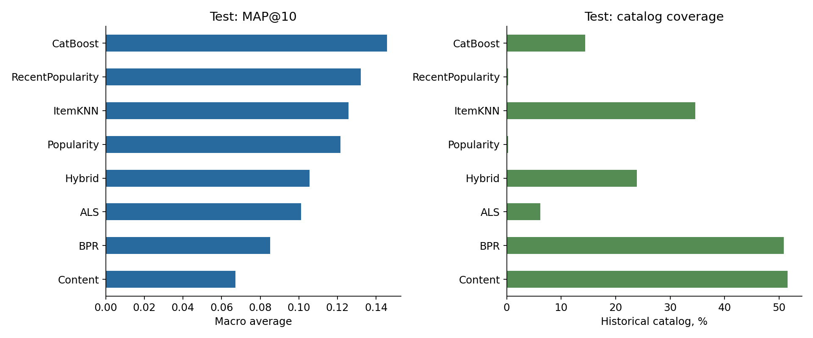

# KION Recommendation System

Рекомендации фильмов и сериалов на данных MTS KION. В проекте сравниваются простые baselines, коллаборативная фильтрация, рекомендации по метаданным и двухэтапная система с CatBoost Ranking.

Задача — предложить пользователю 10 ещё не просмотренных объектов. Качество проверяется по тому, что он посмотрел на следующей неделе.

## Результат

**CatBoost Ranking** получил MAP@10 **0.1456** на неделе 16–22 августа 2021. Это на **10.3%** выше свежей популярности за 7 дней (**0.1319**) и на **19.8%** выше популярности за всю историю. Окно популярности и параметры моделей выбраны на предыдущей неделе.

В оценке участвуют **106 819 пользователей**. Порог просмотра, целевые объекты и каталог одинаковы для всех моделей.

| Модель | MAP@10 | Recall@10 | NDCG@10 | HitRate@10 | Coverage |
|---|---:|---:|---:|---:|---:|
| Popularity | 0.1215 | 0.2366 | 0.1598 | 0.3127 | 0.27% |
| RecentPopularity (7 дней) | 0.1319 | 0.2690 | 0.1762 | 0.3551 | 0.26% |
| ItemKNN | 0.1257 | 0.2487 | 0.1673 | 0.3365 | 34.62% |
| ALS | 0.1012 | 0.2158 | 0.1386 | 0.2949 | 6.21% |
| BPR | 0.0851 | 0.1704 | 0.1127 | 0.2240 | 50.85% |
| Content | 0.0671 | 0.1343 | 0.0880 | 0.1680 | 51.58% |
| Hybrid | 0.1056 | 0.2304 | 0.1460 | 0.3154 | 23.85% |
| CatBoost | 0.1456 | 0.2832 | 0.1920 | 0.3814 | 14.38% |



ItemKNN немного улучшил исходный Popularity и заметно расширил покрытие, но уступил свежей популярности. ALS и BPR в проверенных конфигурациях оказались слабее. Content-Based охватывает много объектов, но редко попадает в будущие просмотры. Простое смешивание списков тоже не улучшило baseline; отдельный ранкер оказался полезнее.

Все модели обучены на полной доступной истории, без выборки пользователей. Основное сравнение семи моделей заняло около **12,5 минуты** на CPU в окружении macOS ARM64 с 16 GB RAM. Его результаты, выбранные параметры и версии библиотек сохранены в [reports/full](reports/full), дополнительные эксперименты — в [reports/study](reports/study).

## Что дали дополнительные эксперименты

**Свежая популярность.** После разбора важности признаков ранкера сравнил популярность за 7, 14 и 30 дней. Она оказалась сильнее исходного baseline, поэтому именно с ней сравниваю итоговое улучшение.

**Признаки ранкера.** На одинаковом пуле кандидатов популярность и активность дали MAP@10 0.1319. Добавление scores и рангов моделей подняло её до 0.1444, а год выпуска, возрастной рейтинг и тип контента — до 0.1456. Основная прибавка появилась после добавления сигналов моделей. Параметры CatBoost во всех трёх вариантах одинаковы; этот опыт проверяет признаки второго этапа, а не отдельный вклад генераторов кандидатов.

**Три недели.** На каждом срезе окно популярности и параметры CatBoost выбирались по предыдущей неделе. Ниже MAP@10:

| Неделя оценки | Окно свежей популярности, дни | Popularity | RecentPopularity | CatBoost |
|---|---:|---:|---:|---:|
| 2–8 августа | 14 | 0.1484 | 0.1534 | 0.1672 |
| 9–15 августа | 7 | 0.1351 | 0.1468 | 0.1607 |
| 16–22 августа | 7 | 0.1215 | 0.1319 | 0.1456 |

CatBoost оказался выше свежей популярности на всех трёх неделях: относительный прирост MAP@10 составил от 9,0% до 10,3%. Абсолютное качество меняется от недели к неделе, но преимущество ранкера в этом сравнении сохранилось.

Подробности и графики — в [ноутбуке 08](notebooks/08_robustness.ipynb). Эти три опыта завершают сравнение; по их итогам новый подбор параметров не проводился.

## Как развивалось решение

1. **Popularity.** Сначала построил рейтинг по числу уникальных зрителей. Это простая точка отсчёта и резервная выдача для новых пользователей.
2. **ItemKNN.** Попробовал учитывать конкретную историю через совместные просмотры. Косинусное сходство считается на SciPy CSR, для каждого объекта сохраняются ближайшие соседи.
3. **ALS и BPR.** Проверил скрытые факторы и обучение на парах объектов. Для ALS сравнил размерность и регуляризацию, для BPR — число факторов.
4. **Content-Based.** Добавил жанры, страны, режиссёров и тип контента: TF-IDF и косинусное сходство. Это позволяет искать похожие объекты без общих зрителей.
5. **Hybrid.** Объединил ранги Popularity, ItemKNN, ALS и Content через Reciprocal Rank Fusion. Два набора весов проверил на Validation.
6. **CatBoost Ranking.** Сначала собрал кандидатов от четырёх моделей, затем обучил ранкер учитывать их scores, популярность, активность пользователя и метаданные.
7. **Проверка результата.** Сравнил ранкер со свежей популярностью, по очереди добавил группы признаков и повторил оценку на трёх неделях.

## Данные

Источник — [официальный датасет MTS KION](https://github.com/irsafilo/KION_DATASET), [Petrov et al., 2022](https://arxiv.org/abs/2209.00325).

- **5 476 251** взаимодействие;
- **962 179** пользователей;
- **15 706** объектов с просмотрами;
- период в CSV — **13.03.2021–22.08.2021**.

`interactions.csv` содержит даты и характеристики просмотров, `items.csv` — метаданные контента, `users.csv` — сведения о пользователях. Последняя таблица используется в EDA для проверки покрытия, но не входит в признаки моделей.

У пользователя в медиане только два объекта в истории. У фильма в медиане 12 зрителей, хотя отдельные хиты собирают больше 200 тысяч. Поэтому рекомендации по популярности здесь оказались сильной базой, а разрез по длине истории оказался полезнее одной общей метрики.

В EDA проверены пропуски, нулевые значения, дубли, диапазоны дат и покрытие метаданными. Пустых `watched_pct` — 828, дубликатов пар user–item нет. Данные контента есть для всех объектов с просмотрами.

## Что считаю положительным просмотром

Использую **`watched_pct >= 20`**, как в исходной версии проекта. После фильтра остаётся 3,11 млн взаимодействий. Это рабочий способ отделить короткие просмотры; порог не подбирался по Test.

У фильмов и сериалов процент просмотра распределён по-разному, поэтому порог не стоит воспринимать как универсальное определение интереса. Для сравнения моделей он остаётся одинаковым. В матрице используются единицы, без весов глубины просмотра; отсутствующий процент в положительную историю не включается.

Из выдачи убираются **все уже просмотренные объекты**, в том числе с процентом ниже 20. Если пара повторяется, сначала выполняется временное разбиение, затем внутри периода остаётся одна бинарная единица. Так будущий повтор не удаляет строку из прошлой истории.

## Разбиение и оценка

| Этап | История | Следующие просмотры |
|---|---|---|
| Обучение ранкера | до 02.08.2021 | 02–08.08.2021 |
| Validation | до 09.08.2021 | 09–15.08.2021 |
| Test | до 16.08.2021 | 16–22.08.2021 |

Гиперпараметры выбираются по **Validation MAP@10**. Перед Test основные модели обучаются на всей истории до 16 августа. Ранкер переобучается на двух прошлых окнах: 2–8 и 9–15 августа. Пользователь в разных окнах образует разные ranking queries.

Для обучения ранкера кандидаты и признаки всегда строятся по более ранней истории. Например, признаки для просмотров 2–8 августа рассчитаны по данным до 2 августа. Будущие просмотры используются только как целевая переменная.

В оценку входят все пользователи с новым положительным объектом в следующем окне. Новые пользователи тоже включены: базовые модели дают им популярные объекты. Отдельно показаны группы по числу прошлых положительных просмотров: 0, 1, 2–5, 6–20, 21+.

Каталог состоит из объектов с положительным просмотром до начала периода. Его размер одинаков для всех моделей: 13 087 на Validation и 13 266 на Test. Если будущий объект ещё не входит в каталог, он остаётся в целевых данных и даёт промах. TF-IDF обучается только на историческом каталоге.

### Метрики

Все метрики качества усредняются по пользователям:

- **MAP@10:** средний AP@10; AP — сумма precision на релевантных позициях, делённая на `min(10, число релевантных объектов)`.
- **Recall@10:** какую долю следующих положительных объектов нашла модель.
- **NDCG@10:** насколько высоко стоят релевантные объекты; скидка позиции — `1 / log2(rank + 1)`.
- **HitRate@10:** доля пользователей хотя бы с одним попаданием.
- **Coverage:** какая доля исторического каталога попала в рекомендации.

Отсутствующая выдача даёт ноль. Все модели сравниваются на одних и тех же целевых множествах.

## Как устроен второй этап

Для каждого пользователя объединяются top-30 от **Popularity, ItemKNN, ALS и Content**. После пересечений в Test остаётся в среднем около 72 кандидатов. Их параметры заранее зафиксированы в `candidate_models`; BPR в этот пул не включён.

CatBoost обучается с **PairLogit**. В признаки входят ранги источников, число источников кандидата, ALS score, популярность за всю историю и за последнюю неделю, активность и давность истории пользователя, год выпуска, возрастной рейтинг и тип контента. Сырые ID не используются как признаки.

Целевые объекты не добавляются в пул вручную. Если их не нашёл ни один генератор, они останутся промахами при итоговой оценке. В Test **Candidate Recall = 0,3977**, а итоговый **Recall@10 = 0,2832**. Группы без положительно-отрицательной пары исключаются из pairwise обучения, но остаются в оценке.

Для расчёта сходств используются блоки, для выдачи — батчи. Полная плотная матрица «пользователь × объект» не создаётся. Seed равен 42; ALS/BPR обучаются в одном потоке, CatBoost — на CPU в четырёх. Равные scores упорядочиваются по item ID.

## Структура проекта

```text
notebooks/
  01_eda.ipynb                # исследование данных
  02_baselines.ipynb          # Popularity
  03_itemknn.ipynb            # ItemKNN и длина истории
  04_als.ipynb                # ALS и подбор параметров
  05_bpr_content_hybrid.ipynb # BPR, Content-Based и Hybrid
  06_ranking.ipynb            # кандидаты и CatBoost
  07_comparison_demo.ipynb    # сравнение и персональная выдача
  08_robustness.ipynb         # свежая популярность, признаки, три недели
src/kion_recsys/
  data.py                    # загрузка, разбиение, sparse-матрицы
  metrics.py                 # целевые множества и метрики
  models.py                  # общая выдача, Popularity, ItemKNN
  als.py                     # ALS и BPR
  content.py                 # рекомендации по метаданным
  ranking.py                 # кандидаты, признаки, гибрид, ранкер
  experiment.py              # полный запуск сравнения
  study.py                   # дополнительные три эксперимента
  demo.py                    # рекомендации из командной строки
configs/experiment.json      # параметры основного сравнения
configs/study.json           # окна популярности, даты и группы признаков
reports/full/                # результаты и параметры основного запуска
reports/study/               # результаты дополнительных экспериментов
reports/figures/             # графики
```

В ноутбуках оставлены эксперименты, графики и выводы. Обработка данных, метрики и модели находятся в `src`, чтобы не копировать их между ноутбуками. Проверки качества данных собраны в EDA.

## Запуск

Проверено на **Python 3.11**. Прямые зависимости зафиксированы в `requirements.txt`, полный снимок проверенного окружения macOS — в `requirements-lock.txt`.

```bash
python3.11 -m venv .venv311
source .venv311/bin/activate
python -m pip install -r requirements-lock.txt
python -m pip install --no-build-isolation --no-deps -e .
```

Скачайте [interactions.csv.zip](https://github.com/irsafilo/KION_DATASET/blob/main/interactions.csv.zip) и [data_original.zip](https://github.com/irsafilo/KION_DATASET/blob/main/data_original.zip) у авторов датасета. Создайте папку `data/` и положите туда распакованные `interactions.csv`, `items.csv` и `users.csv`. Для другой платформы можно установить `requirements.txt` вместо полного lock-файла. Данные и окружение исключены из Git.

```bash
OPENBLAS_NUM_THREADS=1 OMP_NUM_THREADS=1 python -m kion_recsys.experiment
jupyter lab
```

Команда сохраняет результаты в `reports/full/`. Для отдельного повторного запуска:

```bash
python -m kion_recsys.experiment --data-dir /path/to/data --output reports/reproduction
```

Свежая популярность, сравнение групп признаков и три временных среза:

```bash
OPENBLAS_NUM_THREADS=1 OMP_NUM_THREADS=1 python -m kion_recsys.study
```

Результаты сохраняются в `reports/study/`, промежуточные таблицы кандидатов — в `artifacts/study/` (около 2,2 GB, исключены из Git). В каждом срезе выбор параметров записывается в `selection_*.json` перед оценкой следующей недели. В `run.json` обоих запусков сохранены размеры и SHA-256 исходных файлов, версии библиотек и сведения о запуске.

Ноутбуки используют сохранённые результаты полного запуска. В 02–04 также повторяется validation-эксперимент выбранной модели. При данных вне проекта перед запуском Jupyter задайте `KION_DATA_DIR=/path/to/data`.

Пример генерации рекомендаций:

```bash
python -m kion_recsys.demo --user-id 3 --model ALS
```

CLI показывает историю до 16 августа и выдачу выбранной модели. Сохранённый пример рекомендаций CatBoost есть в [ноутбуке 07](notebooks/07_comparison_demo.ipynb).

## Ограничения

Выгрузка хранит последнюю дату просмотра пары, а не все события. Поэтому восстановить настоящую историю пользователя на любой день нельзя. Временное разбиение использует только прошлые строки, но всё же остаётся приближением.

Также нет истории показов рекомендаций, пользовательских оценок и дат появления контента в каталоге. Здесь проверяется предсказание следующих просмотров. Как рекомендации повлияют на поведение пользователей, эти данные не показывают; работу с совсем новыми объектами я отдельно не оценивал.

Все восемь подходов сравнены на неделе 16–22 августа. Для Popularity, свежей популярности и полного CatBoost дополнительно выполнены три последовательных временных среза. Сетки параметров небольшие; результаты описывают именно проверенные конфигурации.

Августовские периоды уже встречались в проекте. Дополнительные эксперименты появились после первого сравнения, поэтому это историческая проверка выводов, а не новый неизвестный Test. Внутри каждого среза параметры выбираются по прошлой неделе. По итогам дополнительных расчётов модель больше не настраивалась.

Сравнение групп признаков использует один и тот же пул кандидатов. Оно показывает вклад признаков ранжирования, но не измеряет отдельный вклад каждого генератора или метаданных во всей системе.

## Материалы

- [MTS KION dataset](https://github.com/irsafilo/KION_DATASET).
- [Implicit ALS](https://benfred.github.io/implicit/api/models/cpu/als.html), [BPR](https://benfred.github.io/implicit/api/models/cpu/bpr.html).
- [BPR: Bayesian Personalized Ranking](https://arxiv.org/abs/1205.2618).
- [CatBoost Ranking](https://catboost.ai/docs/en/concepts/loss-functions-ranking).
